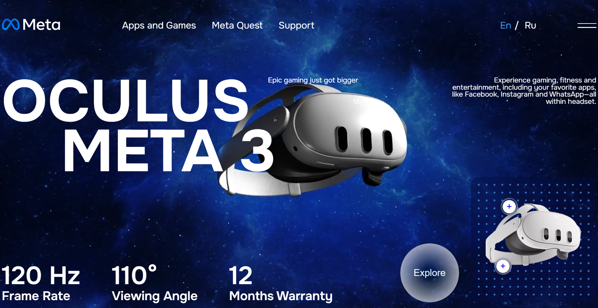

# Oculus Meta 3

Адаптивный лендинг VR-гарнитуры. Учебный проект, не связан с Meta.

🔗 **[Открыть сайт](https://drozdtatsiana.github.io/Oculus/)**



## Что реализовано

- полноэкранный первый экран с фоновым видео
- интерактивная сетка точек на `canvas`, которая реагирует на курсор
- подсказки на кнопках «+» с плавным раскрытием
- адаптивная вёрстка и мобильное меню на бургере
- шрифт Onest через Google Fonts

## Технологии

- HTML5, семантическая вёрстка
- CSS3
- JavaScript (Canvas API)

## Запуск

```bash
git clone https://github.com/drozdtatsiana/Oculus.git
```

Открой `index.html` в браузере.

## Автор

Татьяна Дрозд · [GitHub](https://github.com/drozdtatsiana)
